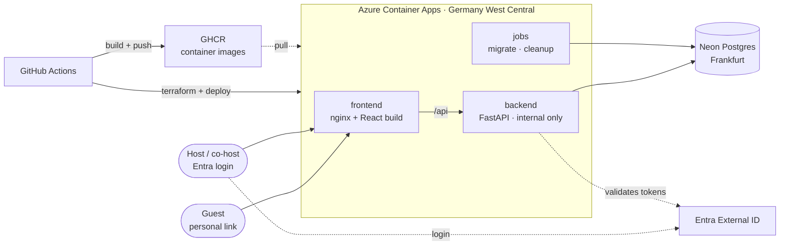

# Architecture

Guestlist is a small web app for private events. A host creates an event, invites households or
single people through personal links, and sees who is coming and what they answered (food, drinks,
allergies, …). Guests never create an account.

- Data model: [data-model.md](data-model.md)
- Why things are the way they are: [decisions.md](decisions.md)

## Overview



- **One domain.** nginx serves the React app and forwards `/api/*` to the backend, so there is
  no CORS. The backend only accepts requests from inside the Container Apps environment.
- **Two images.** `frontend` (nginx) and `backend` (FastAPI). Migrations and the daily cleanup
  run as Container Apps Jobs from the **backend image** with a different command.
- **Scales to zero.** Container Apps and Neon both sleep when idle. The first request after a
  quiet period takes a few seconds.

## Tech stack

| Area | Choice |
|---|---|
| Backend | Python 3.13, FastAPI, Pydantic v2 |
| Database access | SQLAlchemy 2 ORM (sync, psycopg 3), Alembic migrations |
| Python tooling | uv (dependencies, lockfile), ruff (lint + format), pytest |
| Frontend | React + Vite + TypeScript |
| i18n | react-i18next with `de.json` / `en.json`; host-written text stored as JSONB `{"de", "en"}` |
| API contract | OpenAPI from FastAPI → openapi-typescript → openapi-fetch |
| Auth | Microsoft Entra External ID (OIDC) for hosts; personal token links for guests |
| Database | PostgreSQL 17: Neon in production, Docker locally |
| Hosting | Azure Container Apps (consumption plan) |
| Registry | GitHub Container Registry (GHCR) |
| Infrastructure | Terraform |
| CI/CD | GitHub Actions |

## Backend layers

Every rule has exactly one home.

```
Browser (React)              shows rules for convenience, never enforces them
   │ HTTP
   ▼
① routers/ + schemas/        is the request well-formed?   types, required, lengths, allowed values
   │
   ▼
② services/                  is this allowed right now?    rules that need existing data
   │
   ▼
③ models/ → Postgres         must never be violated        NOT NULL, foreign keys, unique, CHECK
```

- **Routers stay thin:** parse the request, call one service function, return the result.
- **Schemas are the API contract.** They're separate from the models, so database-only fields
  (e.g. internal IDs and tokens) can never leak into a response by accident.
- **Services** hold the business rules, e.g. "a contact is invited at most once per event" or
  "answers close at the deadline". Each use case is one function that every path goes through
  (admin UI, imports, later features).
- **The database** enforces only cheap rules that must always hold.

## API contract (cannot drift)

```
backend Pydantic schemas
   │  scripts/export_openapi.py
   ▼
contract/openapi.json                 committed
   │  openapi-typescript
   ▼
frontend/src/api/schema.d.ts          committed, never edited by hand
   │  openapi-fetch
   ▼
frontend code                         every call is type-checked against the contract
```

CI regenerates both files and fails on any `git diff`, then runs `tsc --noEmit`. A backend change
that breaks the frontend fails the build. At runtime, FastAPI's `response_model` validates
everything the backend sends.

## Authentication and roles

- **Guests:** the link holds a random token (`/i/<token>`). The token only gives access to that
  one invite. No login. The page sends it to the API in an `X-Invite-Token` header, so API URLs
  never contain it (A20). Because the secret sits in the page URL:
  - tokens come from `secrets.token_urlsafe(32)` (256 bits)
  - nginx sends `Referrer-Policy: no-referrer`, so the link never leaks to third-party sites
  - access logs mask the token part of `/i/<token>`
- **Hosts:** log in through Entra External ID. The frontend uses `react-oidc-context`. The backend
  validates the JWT against the tenant's JWKS: issuer, audience = the API's app registration,
  scope.
- **Code stays provider-agnostic** (standard OIDC, not MSAL-specific). Switching providers means
  changing configuration, not code.
- **Roles are per event and live in Postgres** (`event_roles`: owner / admin / viewer). Login
  identities are mapped to our own users via `identities`.

## Data lifecycle

- **Event data is deleted 90 days after the event** (after `ends_at`, or after `starts_at` if
  there's no end), unless `keep_data` is set. A daily Container Apps Job does this, and cascades
  remove everything below the event.
- **The address book (contacts, groups) is never deleted automatically.**
- **Inviting copies** contacts into the event. Event and address book never break each other.

## Environments

| | Local | Production |
|---|---|---|
| Database | Postgres 17 in Docker (`compose.yaml`) | Neon, Frankfurt |
| Backend / frontend | `compose.yaml` or `uv run` / `npm run dev` | Azure Container Apps |
| Auth | dev bypass (`AUTH_DEV_BYPASS=true`, A13) | Entra External ID |

## Repository layout

```
guestlist/
├── backend/                     FastAPI service (uv project)
│   ├── app/
│   │   ├── main.py              creates the FastAPI app, mounts routers
│   │   ├── config.py            settings from environment variables
│   │   ├── db.py                engine + session
│   │   ├── auth/                OIDC token validation, current user
│   │   ├── models/              ③ SQLAlchemy tables
│   │   ├── schemas/             ① Pydantic request/response models = the API contract
│   │   ├── services/            ② business rules and role checks, one module per area
│   │   ├── routers/             thin HTTP layer: guest, admin, health
│   │   └── jobs/                cleanup (90-day retention)
│   ├── migrations/              Alembic
│   ├── scripts/                 export_openapi.py
│   ├── tests/
│   ├── alembic.ini
│   ├── pyproject.toml + uv.lock
│   └── Dockerfile
├── frontend/                    React + Vite
│   ├── src/
│   │   ├── api/                 schema.d.ts (generated) + client.ts
│   │   ├── auth/                OIDC setup
│   │   ├── i18n/                de.json, en.json
│   │   ├── features/guest/      RSVP page behind the personal link
│   │   ├── features/admin/      events, invites, address book, dashboard
│   │   └── components/          shared UI
│   ├── nginx.conf.template      serves the build, forwards /api to the backend
│   ├── package.json
│   └── Dockerfile
├── contract/
│   └── openapi.json             generated from the backend, committed
├── infra/                       Terraform
│   ├── bootstrap/               one-time: storage account for Terraform state
│   └── main/                    resource group, Container Apps env, apps, jobs, secrets
├── .github/workflows/
│   ├── ci.yml                   lint, test, contract drift check, build images
│   └── deploy.yml               push to GHCR, terraform apply, run migrations, deploy
├── docs/
│   ├── architecture.md          this file
│   ├── data-model.md
│   └── decisions.md
├── compose.yaml                 local dev: postgres + backend + frontend
└── README.md
```

**Why it's laid out this way:**
- **`contract/` sits at the top level** because it belongs to neither side alone. Both the backend
  export and the frontend generator point at it, and contract changes show up as their own diff in
  pull requests.
- **`infra/bootstrap` is separate from `infra/main`.** Terraform needs somewhere to store its
  state before it can manage anything else. That storage is created once by hand, everything else
  by CI.
- **Each top-level folder has one owner tool:** uv (`backend/`), npm (`frontend/`), Terraform
  (`infra/`), GitHub (`.github/`). CI jobs map 1:1 to folders.
