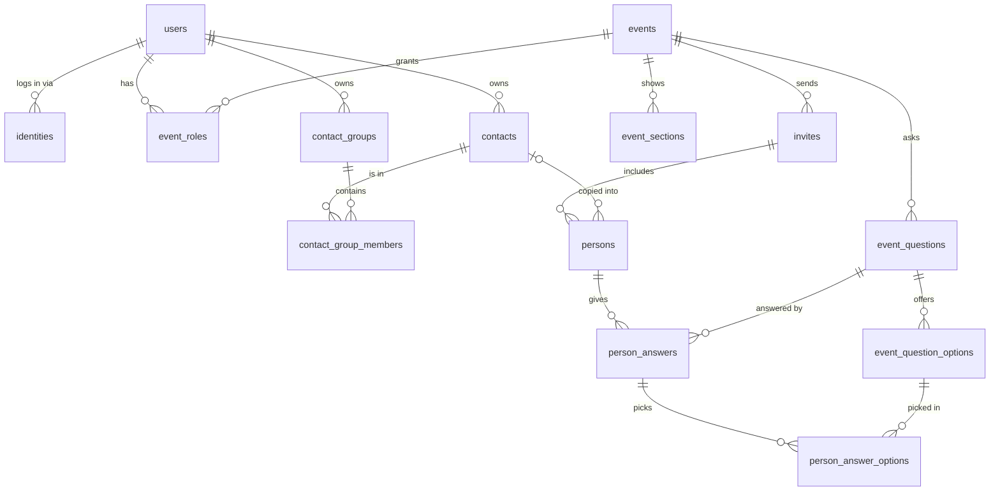

# Data model

14 tables in 4 areas. Source of truth: `backend/app/models/`. This page explains them.

**Every table has `created_at` and `updated_at`** (filled in automatically), so they're left out
below. 🔑 = primary key, → = foreign key, *italic* = optional. All IDs are UUIDs.

```
 1 WHO MANAGES          2 ADDRESS BOOK                3 THE EVENT                    4 THE GUESTS
 users                  contacts                      events                         invites
 identities             contact_groups                event_sections                 persons
 event_roles            contact_group_members         event_questions                person_answers
                                                      event_question_options         person_answer_options

 logins + rights        per user, kept forever        what the host sets up          what guests answer
                                                                                     (deleted 90 days after the event)
```



## 1. Who manages

*People who log in and what they may do. Guests never appear here.*

**`users`**
| column | type | note |
|---|---|---|
| 🔑 id | UUID | |
| email | text | unique regardless of case |
| display_name | text | |

**`identities`**: "this login provider account is that user"
| column | type | note |
|---|---|---|
| 🔑 id | UUID | |
| user_id | → users | |
| issuer | text | which login provider |
| subject | text | the user's ID there; issuer + subject is unique |

**`event_roles`**
| column | type | note |
|---|---|---|
| 🔑 event_id | → events | |
| 🔑 user_id | → users | |
| role | `owner` / `admin` / `viewer` | several owners allowed |

## 2. Address book

*Each user's own people and groups, reused across events. A contact can be in several groups.*

**`contacts`**
| column | type | note |
|---|---|---|
| 🔑 id | UUID | |
| owner_user_id | → users | whose address book |
| name | text | |
| *birth_year* | number | |

**`contact_groups`**
| column | type | note |
|---|---|---|
| 🔑 id | UUID | |
| owner_user_id | → users | |
| name | text | "Familie Müller" |

**`contact_group_members`**
| column | type | note |
|---|---|---|
| 🔑 group_id | → contact_groups | |
| 🔑 contact_id | → contacts | |
| position | number | display order |

## 3. The event

*What the host sets up.*

**`events`**
| column | type | note |
|---|---|---|
| 🔑 id | UUID | |
| title | DE/EN text | |
| *description* | DE/EN text | |
| *location* | text | address, used for the maps link and calendar invite |
| starts_at | timestamp | |
| *ends_at* | timestamp | multi-day events |
| *rsvp_deadline* | timestamp | answers close here, otherwise at `starts_at` |
| default_language | `de` / `en` | |
| keep_data | yes/no | default no: deleted 90 days after the event |
| guest_list_enabled | yes/no | default no: show the attendance list to guests |

**`event_sections`**: info cards such as "Dress code" or "Parking"
| column | type | note |
|---|---|---|
| 🔑 id | UUID | |
| event_id | → events | |
| title | DE/EN text | |
| body | DE/EN text | plain text, never rendered as HTML |
| position | number | display order |

**`event_questions`**: e.g. "Food", "Drinks", "Allergies"
| column | type | note |
|---|---|---|
| 🔑 id | UUID | |
| event_id | → events | |
| label | DE/EN text | |
| kind | `choice` / `text` | pick from options, or free text |
| multiple | yes/no | several options allowed |
| required | yes/no | |
| position | number | display order |

**`event_question_options`**: e.g. "Vegetarian", "Wine"
| column | type | note |
|---|---|---|
| 🔑 id | UUID | |
| question_id | → event_questions | |
| label | DE/EN text | |
| active | yes/no | hide instead of delete |
| position | number | display order |

## 4. The guests

*Who is invited, who comes, and what they answered. Deleted together with the event.
Answers are always private; only attendance can be made public.*

**`invites`**: one personal link
| column | type | note |
|---|---|---|
| 🔑 id | UUID | |
| event_id | → events | |
| name | text | "Familie Müller" |
| token | text | the secret part of the link, unique, stored as-is |
| *comment* | text | from the guest |

**`persons`**: the people in an invite (created by the admin, guests can't add any)
| column | type | note |
|---|---|---|
| 🔑 id | UUID | |
| invite_id | → invites | |
| *contact_id* | → contacts | link back; cleared if the contact is deleted |
| name | text | copied from the contact |
| attendance | `pending` / `yes` / `no` / `maybe` | default `pending` |
| *attendance_changed_at* | timestamp | set by the service whenever `attendance` changes |
| attendance_public | yes/no | default no: show this person's attendance to other guests |
| position | number | display order |

**`person_answers`**: one person's answer to one question
| column | type | note |
|---|---|---|
| 🔑 id | UUID | |
| person_id | → persons | |
| question_id | → event_questions | one answer per person per question |
| *text_value* | text | for free-text questions |

**`person_answer_options`**: which options were picked
| column | type | note |
|---|---|---|
| 🔑 answer_id | → person_answers | |
| 🔑 option_id | → event_question_options | |

## What happens on delete

| You delete… | What happens |
|---|---|
| an **event** | its sections, questions, options, invites, persons and answers are deleted with it |
| an **invite** | its persons and their answers are deleted |
| a **question** | its options and all answers to it are deleted |
| an **option** someone picked | **blocked** at commit (deferred `NO ACTION`); set it inactive instead |
| a **contact** | its group memberships are deleted; in events the person stays and only loses the link back (`SET NULL`) |
| a **user** | their logins, roles, contacts and groups are deleted; events stay |

`person_answer_options → event_question_options` is `NO ACTION` **and `DEFERRABLE INITIALLY
DEFERRED`**, so it's checked at commit. A plain `NO ACTION` isn't enough: Postgres runs every
cascade as its own internal statement and checks right after it, so deleting a question (or the
whole event) would fail as soon as its options are gone, before the cascade through
`person_answers` has removed the picks. Deferred, the check runs once everything is deleted.
A single picked option still can't be deleted; the error appears at commit, so the service checks
first and gives a friendly message (D24).

## Other checks in the database

- `events`: `ends_at` is empty or not before `starts_at`
- `event_questions`: `multiple` is only allowed for `kind = 'choice'`

## Conventions

- **Allowed values** (role, attendance, kind, language) are stored as text plus a CHECK
  constraint, not as native Postgres enums. That keeps them easy to change in migrations.
- **Constraint names** follow a fixed naming convention (`pk_`, `fk_`, `uq_`, `ck_`, `ix_`), so
  Alembic migrations are predictable.
- **JSONB is only used for text guests see that needs translating.** Names, addresses and
  comments are plain text. The database doesn't check what's inside JSONB; Pydantic does.
- **Nothing derived is stored.** Invite status, headcounts and food totals are calculated from
  `persons` and `person_answers`.

## Rules that live in the service layer (not the database)

Built (`backend/app/services/`):
- roles: viewer reads, admin edits, owner also deletes the event; the creator becomes owner;
  events you have no role on look like they don't exist (404)
- children (sections, questions, options) are only looked up under their own event or question,
  so an ID from another event is "not found"
- DE/EN text has only `de`/`en` keys (schema), and at least the event's `default_language` is
  filled in (service)
- an option someone picked can't be deleted, only set inactive (D24)
- answers are only accepted until `rsvp_deadline`, otherwise until `starts_at`
  (`Event.answers_close_at`)
- a person only answers questions of their own event (`event_questions.event_id` =
  `invites.event_id`): the service loads the event's questions through the invite and rejects
  any `question_id` outside that set; persons are only found within the invite
- a `choice` question with `multiple = false` gets at most one option, and every option belongs
  to its question; new picks need an active option (D28)
- text questions take text, choice questions take options
- a person who says "yes" answers every required question that can be answered (D27)

Still to build:
- an event always keeps at least one owner (once roles can be changed)
- a contact is invited at most once per event
- a contact group and its contacts belong to the same user
